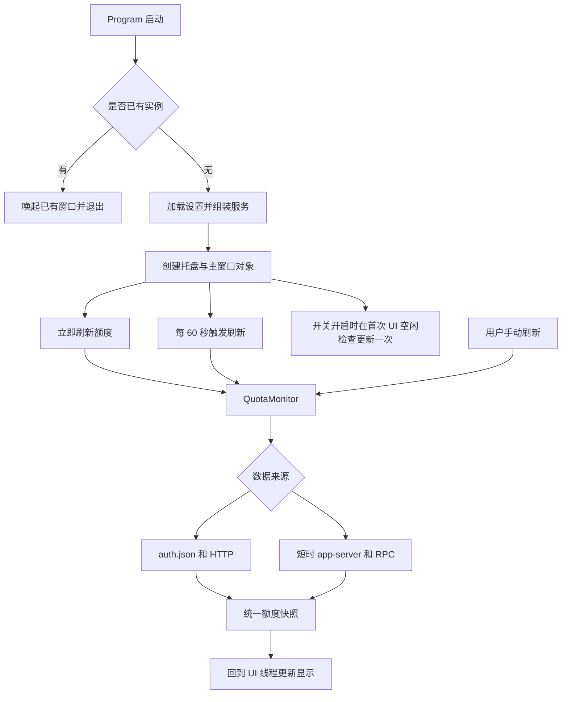
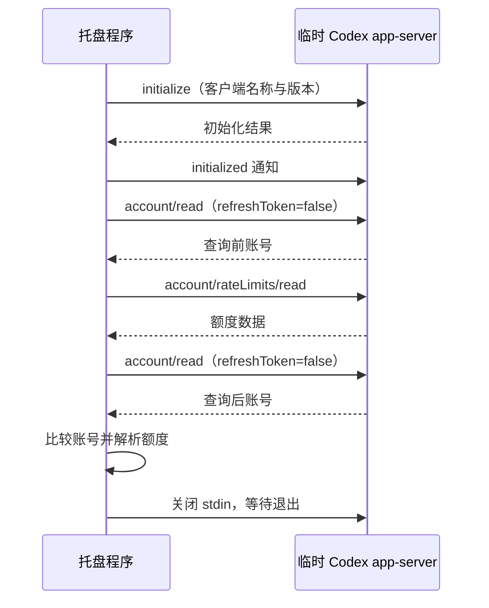

# CodexQuotaTray：架构、实现与取舍

本文说明当前程序实际如何工作，以及这些实现带来的风险和成本。实现基线为 `v1.4.0.3` 对应的代码提交 `76ae1ed`；本文于 2026-11-27 补充了 1.4.1 的更新开关、文档提交过滤和 1.5.0 的随 Codex 桌面端启动实验功能、1.5.1 的跟随退出行为，其余架构以该基线为准。

文中的“已实现”来自源码；“潜在风险”是根据代码路径作出的分析，不代表已经发生过故障；“建议”不代表当前已经具备相应功能。本文没有给出未经测量的 CPU、内存或兼容性保证。

## 1. 程序的边界

CodexQuotaTray 是一个独立的 Windows 托盘程序，使用 C#、.NET 10 和 WinForms。它展示 Codex 的额度窗口及重置时间，默认每分钟刷新一次。

当前存在两条数据通路：

| 模式 | 托盘程序具体做什么 | 谁处理登录令牌 |
| --- | --- | --- |
| `auth.json · 官方接口` | 识别登录目录，读取文件，向固定官方地址发送 HTTP GET | 托盘程序读取令牌，Codex 负责原有登录与续期 |
| `Codex app-server` | 识别 Codex 程序与目录，临时启动一个 stdio app-server，通过 RPC 查询 | 新启动的 Codex 子进程 |

**直接接口模式没有通过 HTTP 向正在运行的 Codex 进程请求额度。** 活跃进程用于识别目标登录目录，实际 HTTP 请求发往 `chatgpt.com`。

**app-server 模式也没有连接桌面端正在使用的私有管道。** 它启动独立查询子进程，尝试复用同一目录中可共享的登录状态。目录相同，并不必然代表可以共享宿主仅存在内存中的账号。

当前不包含插件、自建 Windows 服务、常驻启动监听器或自动下载覆盖模块。v1.5.0 增加默认关闭的“随 Codex 桌面端启动（测试）”，由系统任务计划订阅现有事件日志。“开机自启”实际是当前用户登录 Windows 后启动程序。

## 2. 项目组织与依赖方向

```text
src/
  CodexQuotaTray.Core/           额度模型、查询协调、协议和解析
    QuotaMonitor.cs
    QuotaSource.cs
    CodexCredentials.cs
    CodexSession.cs
    UsageClient.cs / UsageParser.cs
    AppServerProtocol.cs / AppServerUsageParser.cs
    QuotaSnapshot.cs
    UpdateClient.cs

  CodexQuotaTray/                Windows 平台实现与界面
    Program.cs
    Infrastructure/             进程、凭据目录、设置、托盘和自启
    Presentation/               窗口、交互与图标绘制

tests/CodexQuotaTray.Tests/      独立控制台检查程序
build.ps1                       本地构建、检查、发布与打包
.github/workflows/release.yml   main 分支自动发行
```

Windows 项目依赖 Core，Core 不依赖 WinForms。`Program` 直接创建并组装对象，没有引入依赖注入容器。

核心接口的职责如下：

| 接口或类型 | 职责 |
| --- | --- |
| `ICodexActivity` | 判断是否有可识别的本地 Codex 活动进程 |
| `ICodexSessionSource` | 选择具体进程、登录目录及存储覆盖项 |
| `ICredentialSource` | 在直接接口模式中读取凭据 |
| `IUsageClient` | 使用指定凭据查询官方 HTTP 接口 |
| `IQuotaSource` | 将两种来源统一成“连接身份 + 查询函数” |
| `QuotaConnection` | 保存一次查询的身份标识和读取委托 |
| `QuotaMonitor` | 协调刷新、超时、并发保护、旧数据与切换检查 |
| `QuotaSnapshot` / `QuotaState` | 分别表示额度快照，以及快照、错误信息组成的显示状态 |
| `IUpdateClient` | 独立查询 GitHub 版本，不参与额度鉴权 |

这种拆分使协议解析、版本比较和部分状态行为能够使用模拟数据检查。代价是 Core 仍包含文件读取和 HTTP 实现，并不是完全无 I/O 的纯领域层；Windows 进程识别、真实登录兼容性仍需要平台验收。

## 3. 启动与一次刷新



正常启动先初始化 WinForms，再取得单实例互斥锁。首个实例创建 HTTP 客户端、进程识别服务、偏好存储与监控器。主窗口对象启动时已经创建，但默认不显示。

`TrayApplication` 使用 `Task.Run` 执行刷新，避免进程枚举、文件读取与网络等待堵住 UI。它显式安装 WinForms 同步上下文，使 `await` 后的窗口更新回到 UI 线程。

每次刷新依次执行：

1. 尝试立即取得 `SemaphoreSlim`；已有刷新在途时直接跳过，不排队。
2. 检查 Codex 是否运行；未运行则清除快照，不读取凭据或请求额度。
3. 建立 25 秒取消期限，向当前来源取得 `QuotaConnection`。
4. 如果连接身份与上次不同，清除旧快照。
5. 查询额度。
6. 再检查 Codex 是否运行，并重新取得来源身份。
7. 身份不一致时丢弃结果，否则发布新快照。

UI 层另有 `refreshing` 标记，防止按钮和计时器重复触发。网络失败后通常等待下一分钟，不做连续快速重试。

**时间上的代价：** 60 秒是计时器间隔，不是严格实时承诺。刚发生的用量变化通常要等到下一次查询才显示；休眠、UI 阻塞、网络延迟会进一步推迟。手动刷新可以更频繁触发请求，目前没有额外的最小请求间隔。

25 秒是协作式取消期限。初始活动检测在期限创建前执行，部分同步 Windows 调用也不接受取消令牌，因此不能保证所有异常场景都在严格 25 秒内返回。

## 4. 如何找到活跃 Codex 的登录目录

### 4.1 读取目标进程，而不是沿用托盘自身的环境

`ActiveCodexSessionSource` 枚举当前 Windows 会话中的 `codex.exe`。`ProcessParametersReader` 验证目标进程用户 SID 与当前用户一致，然后只读进程参数区：

- 通过 `NtQueryInformationProcess` 定位 PEB。
- 根据原生 x64 或 WOW64 布局读取 `RTL_USER_PROCESS_PARAMETERS`。
- 读取命令行、当前目录与环境块。
- 环境块最终只保留 `CODEX_HOME`；命令行用于识别运行模式和 `cli_auth_credentials_store` 覆盖项。

未找到 `CODEX_HOME` 时，使用目标用户 Profile 目录下的 `.codex`，再通过目录句柄解析真实路径。相对 `CODEX_HOME` 会被拒绝，因为进程当前目录可能已改变，无法可靠还原启动时目录。

### 4.2 多实例选择

`ForegroundHistory` 使用 Windows 前台窗口事件，在内存中保留最近 32 个 PID 及观察时间。进程祖先关系最多向上追溯 16 层，遇到 Explorer 等公共祖先停止。

候选选择顺序为：

1. 与最近操作的 Codex 窗口相关的候选。
2. 上一次选择且仍然有效的实例。
3. 根据祖先进程名与安装路径识别出的桌面 app-server。
4. 其余可识别的用户会话。

同优先级候选指向不同目录或不同存储方式时，程序报歧义；无法读取的候选也参与判断，避免静默改查另一个账号。同目录、同存储方式的候选按 PID 稳定选择。

### 4.3 这套识别方式的风险

| 风险 | 已有处理 | 剩余限制与代价 |
| --- | --- | --- |
| Windows 内部布局变化 | 区分 x64/WOW64，检查指针、长度与读取结果 | 固定结构偏移仍可能失效，需要维护 |
| 目标进程权限更高或受保护 | 同用户检查、异常转为状态信息 | 不申请调试权限；因此可能识别失败 |
| 前台关系不明确 | 最近窗口历史、上次实例记忆、歧义报错 | 这是启发式选择，不是 Codex 提供的账号绑定接口 |
| Codex 改进程名、启动参数或安装目录 | 排除已知辅助模式，检查桌面路径 | 规则需要随上游变化更新 |
| 同目录但宿主使用内存账号 | 文件模式检查显式存储配置，app-server 检查自身账号 | 目录相同无法证明宿主内存账号一致 |
| 本机进程伪装成 Codex | 同用户、会话与模式筛选 | 没有对选定可执行文件做签名或固定哈希校验 |

这里的“只保留 `CODEX_HOME`”不是“完全没有接触过其他环境变量”。实现会分块读取环境内存并筛选，完整命令行也曾进入解析对象；临时字节缓冲会清空，但托管字符串没有逐项安全擦除。它没有扫描任意堆内存、注入代码或把这些信息写入正常日志。

显式 `--codex-home` 是人工覆盖。直接接口模式会使用指定目录；app-server 模式仍需要解析一个活跃 Codex 来定位可执行文件，并使用识别出的存储覆盖项。因此这个参数不能绕过全部进程识别限制，也应避免将一个实例的程序/存储配置与另一个目录混用。

## 5. auth.json 与直接 HTTP 模式

### 5.1 凭据读取

`FileCredentialSource` 每次读取登录文件前检查存储方式：显式命令行覆盖优先，否则检查 `config.toml` 顶层的 `cli_auth_credentials_store`。非 `file` 模式会被拒绝，以避免读取残留的旧账号文件。

随后以只读方式打开 `auth.json`，允许其他进程同时读写及原子替换。读取字段包括：

```text
auth_mode
tokens.access_token
tokens.account_id
```

支持 ChatGPT 账号的文件凭据；空令牌、异常空白或控制字符会被拒绝。此程序不提供登录界面，不读取 refresh token 来自行续期，也不改写登录文件。

`CodexCredentials` 特意不使用自动输出字段的 record，`ToString()` 返回脱敏文本。账号、令牌与上下文信息经 SHA-256 生成比较指纹。

**指纹不是凭据加密。** access token 本身仍以字符串存在于托盘进程内存中，HTTP 请求也必须使用原始令牌。内存转储、同用户恶意软件或具有更高权限的进程仍是信任边界。

### 5.2 网络请求

```http
GET https://chatgpt.com/backend-api/wham/usage
Authorization: Bearer <access_token>
ChatGPT-Account-Id: <account_id>
Accept: application/json
```

账号 ID 存在时才添加对应请求头。客户端复用连接，不保存 Cookie，禁止 HTTP 自动重定向，解压后的响应按流累计限制为 1 MiB。HTTP 客户端超时为 20 秒，外层刷新另有 25 秒期限。

这里只发送额度 GET，不调用额度重置兑换 POST，也不发送预留额度请求头。401/403 会清除快照；429 和多数网络故障保留旧快照并标记错误。

### 5.3 账号切换检查的强度

自动模式下，`ActiveCredentialSource` 读取文件前后分别解析实例。监控器又在网络请求前后读取凭据，所以一次成功查询通常涉及两次文件读取和四次实例解析。

指纹包含进程上下文、账号 ID 与 token，能够检测很多目录、账号和令牌切换。但它只能比较观察点，不构成与 Codex 登录系统的事务：例如两次观察间发生 A → B → A，或宿主实际使用未落盘的账号，仍无法仅凭文件保证一致。

### 5.4 兼容性与边界

该模式直接依赖后端路径及返回字段。不能仅因地址属于官方域名，就把它当作对本工具承诺长期兼容的接口；鉴权、响应字段或访问策略变化都可能导致失效。

配置检查是少量顶层文本规则，不是完整 TOML、profile 或配置合并解析器。文件起始长度超过 1 MiB 会被拒绝，但解析期间没有独立的累计读取上限；`config.toml` 也通过整文件读取。这些限制不等同于对所有异常本地文件提供严格资源隔离。

托盘没有自行设置自定义代理，但仍受系统网络、TLS 信任和运行环境影响。禁止重定向能降低令牌被转发到其他地址的风险，不能替代操作系统与本机网络环境的可信性。

## 6. app-server 模式

### 6.1 创建短时查询进程

`AppServerQuotaSource` 从选定进程取得 `MainModule.FileName`，直接启动该可执行文件：

```text
codex.exe app-server --listen stdio://
```

它设置 `CODEX_HOME` 和工作目录，按已识别结果传递 `file`、`keyring` 或 `auto` 存储覆盖项；显式 `ephemeral` 模式会被拒绝。标准输入、标准输出与标准错误均重定向，不创建控制台窗口，不开放本程序管理的 TCP 监听端口。

子进程继承托盘的其他环境变量，但会移除 `OPENAI_API_KEY`、`CODEX_API_KEY`、`CODEX_ACCESS_TOKEN`。这只是避免误用三类常见令牌变量，不是完整环境隔离；代理、其他配置变量和工作目录依然可能影响 Codex 行为。

### 6.2 协议调用



每次成功查询包含四个带 ID 的 RPC 请求和一个通知。请求串行发送，只接受匹配 ID 的结果；普通服务端通知被忽略，服务端主动请求返回 `-32601`，不会执行工具请求或替宿主提供令牌刷新响应。

两次 `account/read` 必须返回 `type=chatgpt`，并且账号对象的原始 JSON 文本相等。返回数据支持 `rateLimitsByLimitId` 多桶结构，也兼容 `rateLimits` 单桶结构。

### 6.3 资源和退出处理

stdout 的累计读取量限制为 `1,048,576` 个字符，注意这是字符数，不是 1 MiB 的严格内存上限。解析过程还存在字符串和 JSON 对象开销。实现逐字符读取以限制单行增长，逻辑简单，但比成块解析有更多方法调用与分配成本。

stderr 用固定缓冲持续排空，不保留内容，避免错误管道写满导致死锁，也减少敏感输出进入日志的机会。

查询完成后关闭 stdin，最多等待 500 毫秒；仍未退出时尝试结束本次创建的进程树。取消令牌还注册了终止回调。程序没有有意保留常驻 app-server，但退出是尽力清理，当前未使用 Windows Job Object 的进程绑定机制，不能把它描述为任何崩溃情况下都不会残留子进程。

### 6.4 账号与副作用风险

| 问题 | 当前实现能做什么 | 不能保证什么 |
| --- | --- | --- |
| 文件或安全存储登录 | 让安装的 Codex 自己处理支持的存储方式 | 所有 Codex 版本、安装渠道与账号都可复用 |
| 宿主仅内存登录 | 拒绝已识别的 ephemeral，查询不到账号时报错 | 独立进程读取宿主内存身份 |
| 查询期间换号 | 比较子进程两次返回的账号 JSON | 子进程缓存一定及时反映原桌面端换号 |
| 跨刷新账号变化 | 比较进程、目录、存储构成的连接身份 | 连接身份本身不包含账号 ID 或 token |
| 配置一致性 | 复用目录和一个已识别的存储覆盖项 | 完整复制宿主的 profile、其他 `-c` 参数或内存配置 |
| 查询副作用 | 不发送 thread/turn 创建或额度兑换请求 | Codex 初始化、日志、缓存、数据库或自身鉴权流程完全不写文件 |

两次账号对象比较还可能因无关字段或序列化差异而保守拒绝结果；反过来，账号字段相同也不能证明所有组织、工作区上下文完全相同。

与直接模式相比，托盘本身不需要取得访问令牌，但启动的 Codex 进程仍然有登录权限。这是把鉴权责任交给 Codex，并不是整个程序链条不接触凭据。

每分钟启动和退出一次 Codex 会增加启动延迟、CPU 峰值、文件访问和潜在的共享配置竞争。500 毫秒退出期限有利于及时回收，也可能中断尚未完成的 Codex 内部清理；对上游文件操作的影响取决于 Codex 自身实现，需要实机观察。

## 7. 额度模型、圆环与旧数据

两种解析器最终都生成相同的 `QuotaWindow`：额度桶、显示名称、剩余百分比、窗口总秒数、重置时间。HTTP 秒字段直接使用，app-server 分钟字段乘以 60。

```text
剩余额度百分比 = clamp(100 - 已使用百分比, 0, 100)
剩余时间百分比 = clamp((重置时间 - 当前时间) / 窗口总时长 × 100, 0, 100)
```

缺失时间或额度使用“未知”，不会当作 0% 或 100%。到达重置时间也不推定额度已恢复，等待接口下一次确认。

托盘只显示一个主窗口：优先 `codex` 桶，再按剩余额度从低到高排序；附加额度显示在主窗口列表。左右两半环始终来自同一额度窗口，不能把它理解为左侧固定五小时、右侧固定一周。

图标保持原有形状：左侧额度、右侧时间；剩余额度不超过 10% 为红色，不超过 25% 为黄色，其余为绿色。旧数据用灰色表示。

| 状态 | 当前显示策略 |
| --- | --- |
| Codex 未运行 | 清空快照，等待下一次检测 |
| 新连接身份 | 先清空旧快照，再查询 |
| 成功 | 替换快照并记录查询完成时间 |
| 普通网络失败或超时 | 通常保留旧快照并标记错误 |
| 凭据失效、身份切换、明确的 app-server 查询错误 | 清除快照或丢弃结果 |
| 距上次成功超过 150 秒 | 在下一次状态渲染时判为过期 |

`IsStale` 是状态判断，不是独立定时器。时间半环与倒计时也不是每秒动画。详情列表仅在快照对象或旧数据标志变化时重建；同一快照反复打开、刷新失败或长时间停留时，列表倒计时可能保持上次绘制值。托盘提示在 `Render` 时重新计算，所以两处显示时间可能短暂不一致。

这些数字适合作为状态提示，不是用于精确计费的账本。它们还依赖服务端字段和本机时钟，无法预测一次后续请求具体消耗多少额度。

## 8. 界面与 Windows 集成

### 8.1 WinForms 与 Material 3 风格

`DetailsForm` 展示额度、数据来源、开机自启和链接；`TrayApplication` 负责业务事件。右键菜单只保留打开、刷新、退出。

`MaterialTheme` 提供语义配色；`TonalPanel` 自绘圆角表面；`MaterialButton` 增加悬停、按下及焦点反馈。下拉框、复选框和链接使用原生 WinForms 控件。

它是参考 Material 3 的 WinForms 实现，没有引入官方 Material 组件库，也没有实现完整的 Material 动态配色或交互体系。主题在窗口构造时读取，运行中更改系统主题不会自动重新应用；高对比度提供系统颜色回退，但仍需要实际辅助功能验证。

设置控件不会每分钟重建，避免焦点和选择丢失；额度行在新快照时重建，结构简单，但仍有控件、位图分配，列表较长时也可能影响滚动位置。DPI、多显示器和字体放大需要单独验收，不能由编译成功推断全部正确。

### 8.2 托盘图标

`TrayIcon` 创建隐藏原生消息窗口，以固定 GUID 调用 `Shell_NotifyIconW`。它接收鼠标、键盘及单实例消息，并在 `TaskbarCreated` 广播后重新注册。图标由 `RingRenderer` 绘制，替换时释放旧图标；临时 HICON 也显式销毁。

默认可见性通过当前用户 `Control Panel\NotifyIconSettings` 下本程序对应项的 `IsPromoted` 尝试设置。初始化标记用于避免反复覆盖用户后续折叠选择；注册后每秒尝试一次，最多十次。

这依赖 Windows 的实现细节，不是“保证永不折叠”。系统版本、Explorer 行为、策略或写权限都可能让尝试失败，因此保留系统任务栏设置入口。固定 32 像素托盘绘制尺寸在高 DPI 环境的清晰度也值得验收。

### 8.3 单实例

命名互斥锁包含用户 SID，并位于 `Local\` 命名空间。手动重复启动尝试找到旧实例消息窗口并通知其显示，短暂等待初始化后退出；任务计划携带 `--codex-started` 触发的重复启动直接退出，不打断当前窗口。

单实例范围是同一用户、同一 Windows 会话，不是整台电脑全局。不同交互会话可能各有实例；重复启动也不是把新参数传递给旧实例，新的 `--codex-home` 不会自动重新配置已经运行的程序。

关闭主窗口只隐藏窗口，托盘程序继续运行；通过托盘“退出”才停止计时器、取消请求和释放界面资源。

## 9. 偏好存储与开机自启

数据来源保存在：

```text
%LOCALAPPDATA%\CodexQuotaTray\settings.json
```

文件保存 `Source` 和 `CheckForUpdatesOnStartup`，不保存账号、令牌或额度历史。首次使用默认 `AuthFile`，启动更新检查默认开启，旧设置缺少新字段时也保持开启；文件不存在、损坏、超出 4096 字节或枚举无效时回退默认值。

写入采用同目录临时文件再替换，降低半写入风险。切换来源时先保存偏好，再取消并等待旧请求，创建新的监控器，清除旧数据并立即刷新。保存失败保留原设置，不自动切换到另一种来源。

这里没有跨进程文件锁。不同 Windows 会话使用同一用户目录时，可能同时写固定 `.tmp` 文件，发生覆盖或冲突；“单实例”不能消除跨会话竞争。

开机自启默认关闭，开启时只写当前用户 Run 键中的 `CodexQuotaTray` 值，内容为绝对 EXE 路径与保留的 `--codex-home` 参数。参数按 Windows argv 引用规则处理，代码限制命令不超过 260 字符。

它不注册服务、不保存密码、不要求开机阶段管理员运行。程序清单为 `asInvoker`，实际权限继承启动者。移动或删除 EXE 后，原启动路径会失效，需要重新设置。

界面通过 Run 值是否存在判断开关，没有完整检测系统“启动应用”禁用状态、注册值是否指向当前路径或组织策略。因此勾选不等于一定能在下次登录成功启动。不同安装副本共享同一个启动项与偏好文件。

### 9.1 随 Codex 桌面端启动（测试）

2026-11-27 在本机现有日志中验证：Codex 桌面包 `OpenAI.Codex_26.1120.6357.0_x64__2p2nqsd0c76g0` 启动时，`Microsoft-Windows-AppModel-Runtime/Admin` 的事件 201 包含：

```text
ApplicationName = OpenAI.Codex_2p2nqsd0c76g0!App
ImageName = ChatGPT.exe
Message = [LaunchProcess]
ProcessID = 桌面主进程 PID
```

这里的 `ChatGPT.exe` 属于 Codex 桌面包，不等于普通 ChatGPT 应用。辅助进程也产生事件 201，所以不能只按事件 ID 或 EXE 文件名判断。当前订阅同时限定 provider、事件 ID、应用 ID 和启动消息，不绑定易变的包版本号。

方案比较：

| 方案 | 未启动圆环时的成本 | 限制与取舍 |
| --- | --- | --- |
| 现有应用启动日志 → 任务计划（本次采用） | 复用系统事件/任务服务；无本程序监听进程、无定时轮询 | 依赖特定桌面包和事件实现，不覆盖 CLI |
| Security 4688 → 任务计划 | 无本程序监听进程，但开启进程创建审计会增加全机日志写入 | 可能需要管理员和审计策略变更；未采用 |
| WMI/ETW 常驻监听器 | 需要监听进程或永久事件消费者 | 生命周期、权限和维护复杂；未采用 |
| 定时任务或循环扫描进程 | 周期唤醒、枚举进程，且有启动延迟 | 与节省后台开销的目标不符；未采用 |
| 包装快捷方式启动两个程序 | 几乎没有空闲成本 | 只能覆盖经该入口启动的情况；可作为不支持事件的环境的手动替代 |

实现分成三部分：

1. `CodexStartupRegistration` 生成任务 XML，并通过 `Schedule.Service` 注册/删除 `CodexQuotaTray.FollowCodex.<当前用户 SID>`。每次操作结束释放 COM 引用，不创建额外脚本文件。程序启动和打开设置窗口时异步读取状态，正常额度刷新不查询任务服务；决定自动退出前再读取一次，避免任务在外部被关闭后仍退出。
2. 事件触发器的 `ValueQueries` 从 `Event/EventData/Data[@Name='ProcessID']` 取目标 PID，动作直接启动 EXE，保留显式 `--codex-home`，追加内部参数 `--codex-started`。不能取 `System/Execution/ProcessID`，后者是日志提供者进程。路径与参数分别处理，XML 自动转义，参数复用 Windows argv 引用规则。
3. `Program` 在创建监控器、读取凭据及联网前验证 PID。`CodexStartupProcess` 只申请进程有限查询和令牌查询权限，检查应用 ID、用户 SID 与 Windows 会话；无效或已经退出的进程静默忽略。同会话已有圆环时静默退出，不唤起窗口。首次有效启动保留原有更新检查行为。

任务使用 `InteractiveToken` 和 `LeastPrivilege`，不保存密码、不申请提权。只在当前用户已登录的交互环境启动；禁止唤醒电脑、补跑和手动按需执行，不增加重复定时器。允许电池供电，执行时间设为无限，避免系统默认执行时限终止长驻托盘；重复实例策略为 `IgnoreNew`，再由圆环自身的单实例锁兜底。

**风险与代价：**

- 事件 201 的具体字段来自本机观察，不是 Codex 的稳定公开启动协议。Windows/Codex 更新、非打包安装、日志关闭或组织策略都可能导致漏启动。程序不会自动开启日志、安装 Sysmon 或更改全机进程审计；创建失败会提示，开关不假装成功。
- 订阅的是全机日志。其他用户启动同一应用可能让任务短暂拉起一个验证进程，随后因 SID/会话不符退出；因此不能承诺全机任何情况下都完全无额外进程启动。多交互会话下，任务服务所选会话与目标不符时会放弃启动，不保证每个会话都能跟随。
- PID 校验无法让日志投递和进程存活变成原子操作。Codex 很快退出可能使本次唤起被忽略；验证之后退出则先显示“未运行”，启用跟随后在确认无人运行及宽限期结束时退出。
- 仅支持已验证的 Codex 桌面应用 ID，CLI、普通 ChatGPT 和非打包版本不在范围内。
- 移动或删除 EXE 会留下失效任务，升级若改变目录需关闭再开启。多个安装副本共享当前用户任务；开关读取实际任务是否启用，不验证路径是否仍指向当前副本。
- 开关与登录自启独立，可同时启用；单实例锁防止重复运行。取消勾选会删除任务、取消退出等待并清除观察状态，不结束当前圆环；退出圆环后，下次 Codex 真正启动仍会重新拉起。重新激活一个已经运行的 Codex 窗口不一定产生启动事件。
- v1.5.1 开始，此功能同时跟随退出。圆环运行期间保留原有每分钟刷新与 WinForms 内存，确认最后一个桌面进程退出后结束圆环；只关闭窗口而桌面进程仍在后台时不会退出。没有做 CPU/内存基准测试，不给出未经测量的资源节省百分比。

**v1.5.1 跟随退出实现：**

`CodexExitMonitor` 只在圆环进程内工作。启动时读取任务开关，已启用则选择当前用户、当前会话、应用 ID 匹配的 `ChatGPT` 进程中最早启动的一个，保留其进程对象，使用 `Process.WaitForExitAsync` 等待内核退出通知。通常会选中桌面主进程；无需依赖 Electron 的内部子进程命令行，也不读取环境变量或凭据。

每次收到退出通知后重新扫描，因此其他桌面实例或尚在退出的桌面子进程会阻止圆环提前结束。首次确认没有目标进程时等待 2 秒，再次完整扫描为空才退出；快速重启产生的新进程会重新进入等待。采用原有退出路径，取消额度/更新查询并释放托盘，app-server 模式仍只清理圆环自己创建的查询子进程。

该等待不额外增加定时器、常驻辅助进程或一个阻塞线程。没有可绑定进程或发生查询错误时结束本次等待，由已有的一分钟刷新稍后再绑定。手动或登录启动圆环但尚未观察到 Codex 时不立即退出，便于设置；这种情况下首次发现后来启动的 Codex 可能延迟约一分钟，短于此间隔的完整启动/退出可能被漏过。任务启动参数则明确标记曾有桌面实例，即使它在初次扫描前退出，也会进入退出确认流程。

进程检查现在区分“不是当前桌面实例”和“无法确认”：身份/权限查询失败时不能把结果当作不存在。存在未确认的候选进程、注册任务读取失败或原生等待失败时保留圆环，下一轮尝试；无法读取的其他 `ChatGPT` 进程也可能保守地阻止退出。应用 ID 或进程名被上游更改仍需维护规则。2 秒宽限只能降低重启竞态，最后一次扫描与圆环真正退出之间仍有极短窗口，不能保证任意重启时序下都不中断。

开关关闭会取消等待，并在等待完成后清除观察状态。旧版任务无需修改动作参数，升级到同一路径即可生效。普通 ChatGPT、CLI Codex 和其他用户/会话中的可识别进程均不阻止此桌面跟随退出；如果需要圆环持续监控 CLI，请关闭跟随开关。外部更改任务状态在启动、打开窗口和退出前检查时生效，并非实时订阅系统设置变化。

相关 API：[Process.WaitForExitAsync](https://learn.microsoft.com/en-us/dotnet/api/system.diagnostics.process.waitforexitasync)、[Process.Exited](https://learn.microsoft.com/en-us/dotnet/api/system.diagnostics.process.exited)。测试新增真实子进程退出通知、多实例等待、取消不终止宿主、宽限期重启、无进程与不完整快照的处理。实机还需验收：Codex 完全退出后圆环结束、只关闭窗口但后台仍运行时保留、关闭选项后退出 Codex 不影响圆环、快速重启以及两个发布版本。

离线测试覆盖事件筛选、任务权限/触发结构、特殊字符和末尾反斜线参数、无效 PID 与普通进程拒绝。实机验收可依次执行：开启选项 → 退出圆环 → 彻底退出并重新启动 Codex 桌面端 → 检查托盘出现 → 圆环运行时再次启动 Codex 不应弹出额度窗口 → 关闭选项并退出圆环 → 下次 Codex 启动不应再唤起。分别检查电池状态、登录自启并存、更新检查关闭与两种发布版本。程序测试期间不应依赖仅点击已有 Codex 窗口来触发事件。

相关系统机制见 Microsoft 文档：[事件订阅](https://learn.microsoft.com/en-us/windows/win32/taskschd/eventtrigger-subscription)、[事件值传入动作](https://learn.microsoft.com/en-us/windows/win32/taskschd/eventtrigger-valuequeries)、[任务注册与仅验证 XML](https://learn.microsoft.com/en-us/windows/win32/taskschd/taskfolder-registertask)、[任务安全上下文](https://learn.microsoft.com/en-us/windows/win32/taskschd/security-contexts-for-running-tasks)。这些文档解释任务机制，不保证 Codex 事件字段长期不变。

## 10. 仅启动时检查更新

主窗口提供“启动时检查更新”开关，保存成功后才改变勾选状态。关闭会注销尚未执行的启动回调并取消在途请求，已取消的响应不再提示；重新开启从下次启动生效，不会当场重新查询。更改开关与来源切换互斥，避免偏好相互覆盖。

开关开启时，首次 `Application.Idle` 回调立即注销自己，再通过独立匿名 HttpClient 请求：

```text
https://api.github.com/repos/chocoQAQ/CodexQuotaTray/releases/latest
```

它不访问 Codex 凭据、不发送账号头，禁止自动重定向；整个检查期限为 10 秒，响应限制为 256 KiB。只接受非草稿、非预发布的三段或四段数字版本，可带 `v`/`V` 前缀，三段版本补零后比较。

发现新版弹出是/否，默认选项是否。是打开固定仓库中对应版本的 Release 页面，否仅关闭弹窗。页面地址由验证后的版本标签拼接，不直接采用响应的任意 `html_url`。

正常启动只检查一次；手动刷新额度、打开窗口或重复启动唤起旧实例都不会再次检查。诊断模式不检查。为兼容旧版交接仍保留 `--update-ready` 和 `--skip-update-check` 内部参数，前者只确认启动，不提供安装能力。

这种方式移除了下载校验、进度窗口、文件替换、回滚和重启链条，减少文件锁、权限、杀毒软件干预和升级中断的处理成本。代价是用户需要手动下载替换；持续运行的软件不会获知启动之后的新版本；启动时离线或 GitHub 限流会静默错过本次检查。

程序没有“忽略这个版本”的持久化选项，因此未升级时下次启动可能再次提示。当前版本检查也不核验 Release 附件是否齐全，发行完整性主要依赖 CD 工作流。

## 11. 数据与信任边界

| 信息或操作 | 当前去向 | 需要注意的边界 |
| --- | --- | --- |
| 直接模式 token / account ID | 托盘内存和固定官方 HTTP 请求 | 没有安全擦除所有托管字符串的保证 |
| app-server 账号对象 | 托盘内存中的临时一致性比较 | 可能含账号标识，不应加入调试输出 |
| Codex 环境块与命令行 | 临时读取、解析和筛选 | 筛选减少保留内容，不等于从未读到其他字段 |
| 数据来源偏好 | 本机 settings.json | 默认普通用户文件权限，无额外加密 |
| 自启和托盘可见性 | 当前用户注册表 | 关闭自启只删除自己的 Run 值，不清空其他设置 |
| 更新检查 | GitHub 匿名 API | GitHub 仍可看到正常网络请求的来源及客户端版本信息 |
| 点击仓库/发行链接 | 默认浏览器 | 浏览器的登录状态与隐私策略独立于本程序 |
| 诊断文件 | 用户指定位置 | 包含额度、PID 与登录目录，可能暴露本机用户名和使用情况 |

源码没有自建遥测上报服务。为减少敏感泄漏，错误提示使用筛选后的中文信息，app-server stderr 被丢弃；代价是诊断细节不足，某些鉴权、代理和协议问题在界面上只能看到相同的概括错误。

独立子进程不构成安全沙箱。它以用户权限运行选中的 Codex 可执行文件，读取目录配置，并可能采用系统代理或插件配置。当前项目没有对目标 Codex 做额外的发布者签名验证，因此依赖本机安装来源可信。

## 12. 资源和分发成本

### 12.1 稳态运行

主程序长期保留 WinForms 消息循环、隐藏窗口、托盘图标、HTTP 客户端和前台窗口历史。没有逐秒绘制动画，但每分钟会检测进程；Codex 未运行时仍会进行下一轮检测。主窗口对象启动时即创建，隐藏并不释放整套界面对象。

| 成本项 | 直接接口模式 | app-server 模式 |
| --- | --- | --- |
| 每次成功刷新 | 文件/配置读取、进程识别、一个额度 GET | 进程识别、一个子进程、四个 RPC 请求和一个通知 |
| 持续运行一天的量级 | 约 1440 次计划刷新机会，另加启动及手动刷新 | 同样的刷新机会，若均执行则约 1440 次子进程启动 |
| 凭据处理 | 托盘自己处理 token | Codex 子进程处理 token，托盘处理账号摘要 |
| 启动峰值 | 无额外 Codex 进程 | 会有 Codex 启动、读取配置和退出成本 |
| 网络量 | 可直接看见的一次业务 GET | 由 Codex 内部实现决定，不能把四个 RPC 等同于四次 HTTP |

以上是按代码计算的量级，不是负载实测；休眠、Codex 未运行、失败和跳过刷新都会改变次数。手动快速刷新、多个会话同时运行可能提高请求量；代码未实现跨实例限流或指数退避。

### 12.2 两个发行版本

| 项目 | 内置运行时 | 无运行时 |
| --- | --- | --- |
| 分发内容 | 应用及所需 .NET 运行时 | 应用；依赖用户安装 .NET 10 Desktop Runtime x64 |
| 本次本地 `1.4.0` ZIP 大小 | 47,437,012 字节，约 45.24 MiB | 141,996 字节，约 138.67 KiB |
| 安装体验 | 环境依赖较少，下载较大 | 下载很小，需要管理系统运行时 |
| 维护代价 | 运行时更新通常要重新构建、分发应用 | 运行时由用户或系统维护，缺失或不兼容时无法启动 |

大小来自本次构建产物，仅用于比较，不代表后续版本固定体积，也不等于运行内存占用。两种版本都运行同一套托管代码；无运行时版本没有因为 ZIP 小就消除 .NET 的运行时成本。

没有第三方 NuGet 包，减少了依赖数量，但仍依赖 .NET、Windows、安装的 Codex、官方接口、GitHub Actions 及网络基础设施。平台互操作与自绘 UI 的维护工作由本项目承担。

## 13. 构建与 CI/CD

`build.ps1` 先构建解决方案，再运行检查程序；只有成功后才发布两个 win-x64 单文件版本。ZIP 只包含本次 EXE 与 README，避免把本机诊断或输出目录遗留文件打进去。

当前工作流对 main 推送启用 `paths-ignore`：全部改动均位于根目录 `README.md` 或 `docs/**` 时不运行；混合代码或工作流改动仍会运行，也支持手工触发：

1. Windows runner 安装 .NET 10。
2. 用项目三段版本加工作流运行序号，生成四段发行号。
3. 执行构建、检查和两个版本打包。
4. 校验 ZIP 内容并计算 SHA-256。
5. 上传构建产物。
6. 发布 job 校验哈希，并检查 main 后续是否有非文档差异；只有文档变化时允许本次代码构建继续发布。
7. 创建草稿 Release，上传齐全部附件后公开为 Latest。

默认权限只读，只有发布 job 有仓库内容写权限；官方 Actions 固定提交 SHA。发布过程串行且不取消在途任务，降低附件只上传一部分就中断的风险。

仍然存在以下代价：

- 文档过滤使用 GitHub 的原生路径规则；平台在差异生成超时等特殊情况下可能仍启动工作流。发布前的差异比较达到 300 个文件时保守停止，以免把截断列表误判为纯文档变更，必要时可手动触发。
- 离线检查成功就自动公开，没有人工桌面验收关卡；未覆盖的 UI 或真实登录问题也可能进入 Release。
- SHA-256 能检查文件是否与清单一致，但清单和安装包同源，不能代替独立发布者签名。
- 现有工作流没有代码签名或独立构建证明步骤，下载后的系统提示和信任体验需要单独考虑。
- 固定 Action SHA 不等于完全可复现构建：`windows-latest`、`ubuntu-latest`、`10.0.x` SDK 与外部服务仍会变化。
- 发布前的 main 校验降低旧构建抢占 Latest 的机会，但检查与发布不是仓库级原子事务。
- 更新链接与仓库名称写死在程序中，仓库迁移需要更新客户端。

## 14. 验证范围与后续优先级

当前检查程序包含 31 组离线检查，覆盖两种响应解析、RPC 顺序和错误、取消、偏好文件、匿名更新请求、版本比较、进程参数与选择、凭据切换、HTTP 错误及圆环回归。文件、注册表和进程相关检查使用独立临时样本，不以真实账号作为测试夹具。

功能实现交付时已通过本地构建与这些检查，`v1.4.0.3` 的 CI/CD 成功；使用模拟额度查看过默认与紧凑窗口布局。此次文档编写没有重新运行软件，也没有据此扩大验证结论。

以下仍需用户实机验收：真实 file/keyring/auto 登录、不同 Codex 版本、多账号与多目录、宿主仅内存登录、切换账号时的缓存行为、休眠恢复、代理与企业网络、多个显示器/DPI、系统主题变化、辅助功能、自启被系统禁用、Explorer 重启以及长时间运行的资源占用。

按影响排序，值得后续关注的改进方向是：

| 优先方向 | 可降低的风险 | 引入的成本 |
| --- | --- | --- |
| 明确展示所选实例/目录或脱敏身份 | 减少多实例误解，方便确认实际查询对象 | 界面复杂度和隐私展示取舍 |
| 加强 app-server 身份与配置一致性检查 | 降低宿主、子进程账号不一致的风险 | 依赖上游提供足够信息，增加兼容性工作 |
| 子进程生命周期绑定与真实退出测试 | 减少崩溃或清理竞态留下进程的机会 | 更多 Windows 原生互操作和启动顺序处理 |
| 将显示时间更新与网络刷新分开 | 改善倒计时与旧数据展示一致性 | 增加计时器与少量重绘工作 |
| 最小请求间隔、退避及跨会话协调 | 降低重复刷新、限流和设置写入冲突 | 状态管理更复杂，错误恢复可能更慢 |
| 可选且经过脱敏的诊断信息 | 提高真实网络与登录故障可排查性 | 需要维护严格的敏感信息过滤规则 |
| 签名或人工验收阶段 | 提高发行可信度；文档路径过滤已实现 | CI 配置、证书维护或人工等待成本 |

这些是后续取舍，不是当前已实现的保证。当前设计以少依赖、单托盘进程、按需查询和简化升级路径为目标，接受了启发式识别、分钟级数据延迟、对 Codex/Windows 实现细节的依赖，以及较有限的诊断能力。

## 15. 源码定位

本文以[实现基线提交](https://github.com/chocoQAQ/CodexQuotaTray/tree/76ae1ed3131ec843b4a747357b35a11a6f83bffb)为准，主要核对位置如下：

| 主题 | 源文件 |
| --- | --- |
| 启动、依赖组装和诊断 | `src/CodexQuotaTray/Program.cs` |
| 刷新、来源切换、更新提示与退出 | `src/CodexQuotaTray/Presentation/TrayApplication.cs` |
| 查询状态与并发 | `src/CodexQuotaTray.Core/QuotaMonitor.cs`、`QuotaSource.cs` |
| 进程参数与目录选择 | `src/CodexQuotaTray/Infrastructure/ProcessParametersReader.cs`、`ActiveCodexSessionSource.cs`、`ForegroundHistory.cs`；Core 的 `CodexSession.cs` |
| 文件鉴权与 HTTP | `src/CodexQuotaTray.Core/CodexCredentials.cs`、`UsageClient.cs`、`UsageParser.cs` |
| app-server 启动与 RPC | `src/CodexQuotaTray/Infrastructure/AppServerQuotaSource.cs`；Core 的 `AppServerProtocol.cs`、`AppServerUsageParser.cs` |
| 额度与旧数据模型 | `src/CodexQuotaTray.Core/QuotaSnapshot.cs` |
| 主窗口与绘图 | `src/CodexQuotaTray/Presentation/DetailsForm.cs`、`MaterialTheme.cs`、`RingRenderer.cs`、`QuotaText.cs` |
| 偏好、单实例与 Windows 集成 | `src/CodexQuotaTray/Infrastructure/AppSettings.cs`、`SingleInstance.cs`、`StartupRegistration.cs`、`TrayIcon.cs`、`TrayVisibility.cs` |
| GitHub 检查 | `src/CodexQuotaTray.Core/UpdateClient.cs` |
| 构建、发行与检查 | `build.ps1`、`.github/workflows/release.yml`、`tests/CodexQuotaTray.Tests/Program.cs` |
